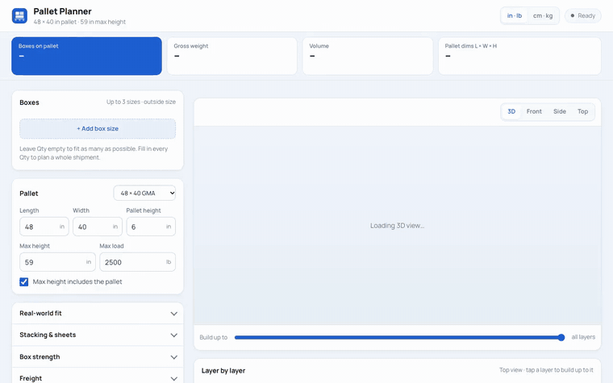
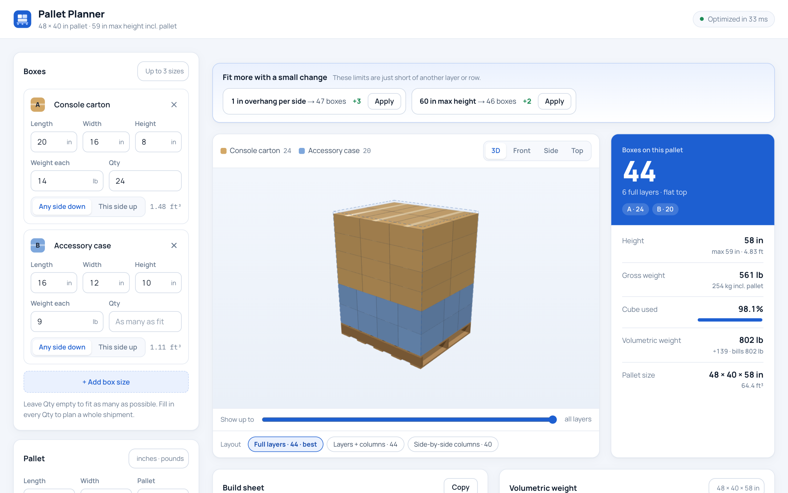
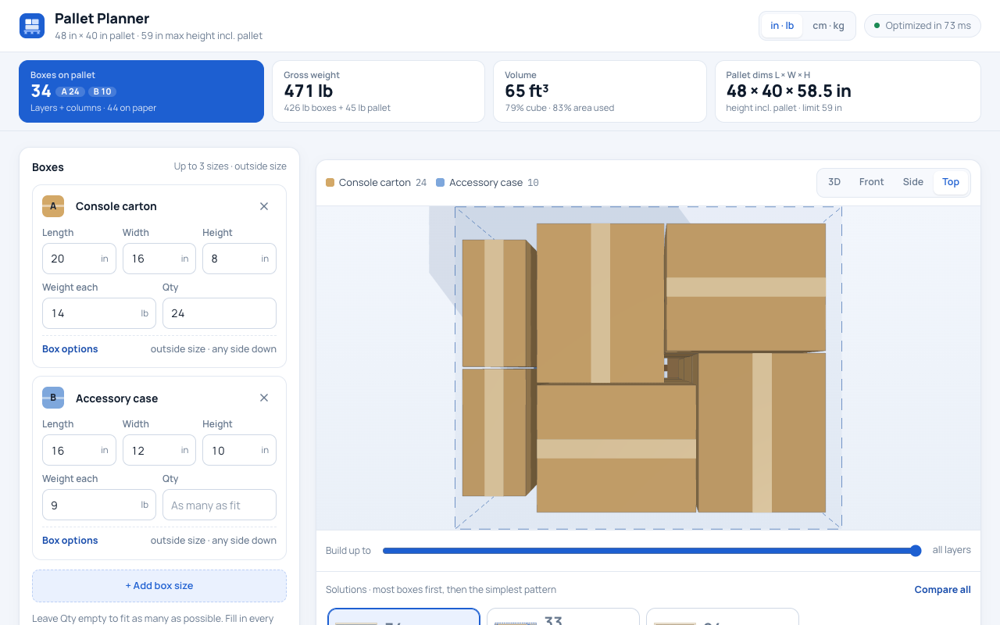
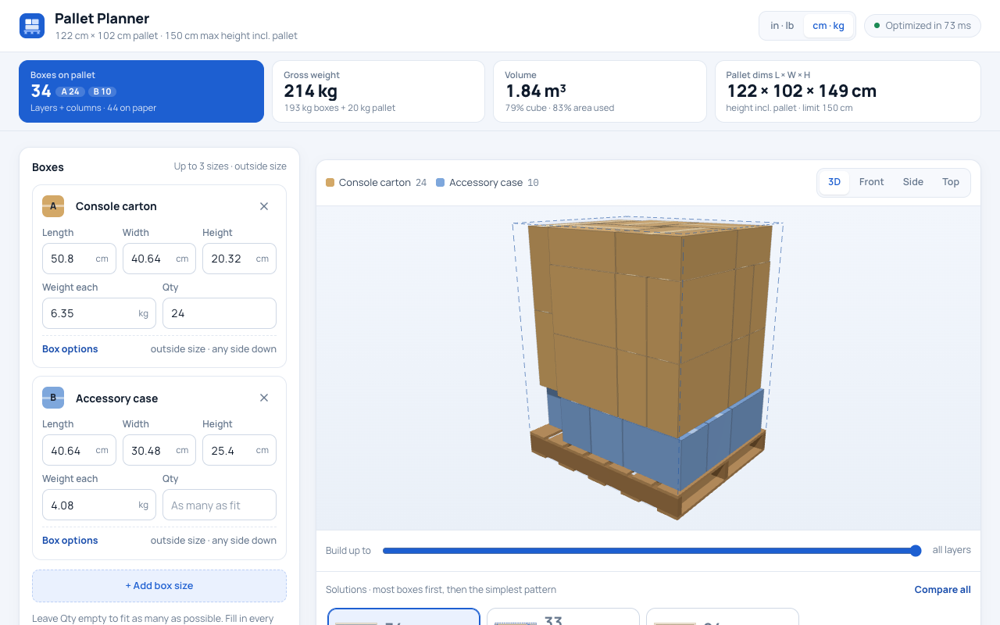
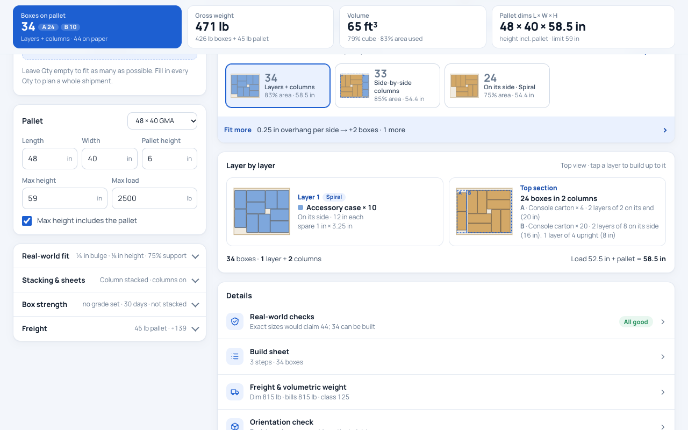

# Pallet Planner - Accurate 3D Visualised Logistics Pallet Calculator

A pallet loading calculator I built to figure out how to stack mixed box sizes onto a standard pallet as efficiently as possible, while still being something warehouse staff can actually build by hand. Live at [plt.techtrove.ca](https://plt.techtrove.ca).

<a href="media/demo.mp4">Watch the full-quality video</a>

## Why I built it

Most online pallet calculators treat boxes as perfectly rigid shapes with zero clearance between them — which looks great on paper but doesn't work in real life, since cartons bulge slightly and warehouse staff need a pattern they can actually follow without a diagram in hand. I wanted a tool that accounts for real carton behaviour (bulge, crushing, uneven support) and gives a build order a person can follow, not just a number.

## What it does

- Takes up to three different box sizes and quantities, in inches or centimetres
- Searches multiple ways to arrange the load — full layers, column-based zones, and a mix of both — and ranks the results by how many boxes fit and how simple the pattern is to build
- Shows a 3D view of the finished pallet plus a layer-by-layer breakdown
- Applies real-world rules: bulge allowance, a minimum amount of support under each box, weight limits, and tall/narrow boxes that would tip over
- Calculates total weight, volume and freight class
- Works entirely in the browser — no server, no account needed

## Screenshots

**3D view**

**Top view**

**Metric units**

**Solutions and layer-by-layer plan**

## Tech used

Plain JavaScript, with the packing and stacking logic running in a Web Worker so the interface stays responsive on large problems. No frameworks, no backend.

---

This repository is a public overview only — the solver and layout logic are kept private.
